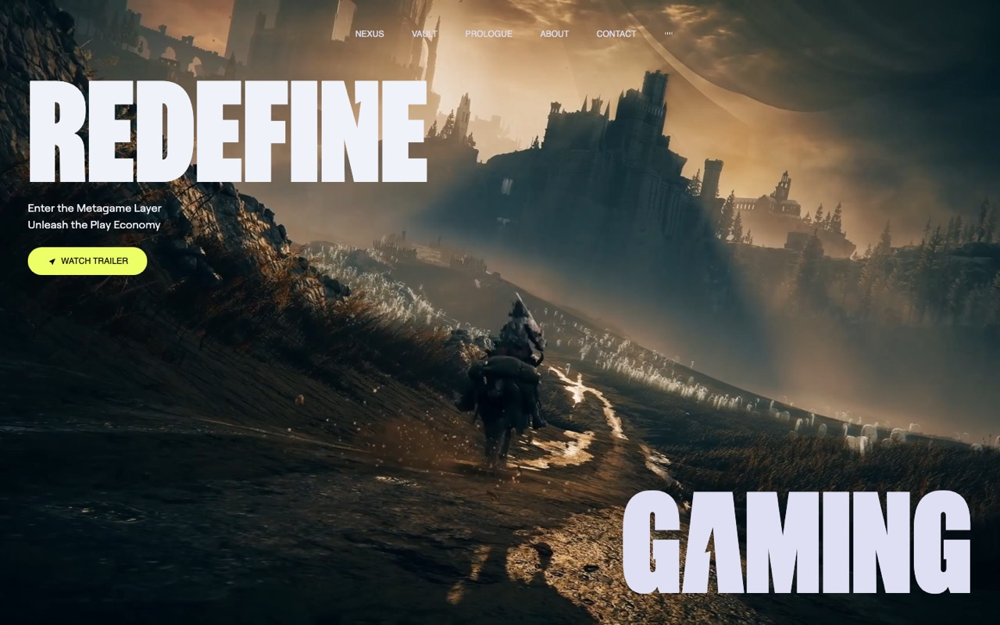
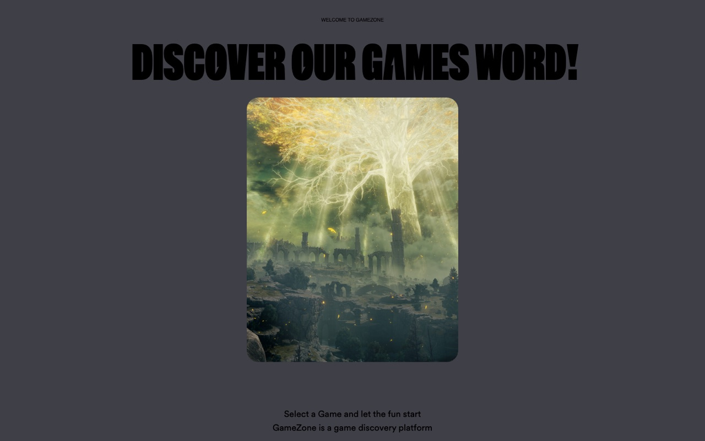
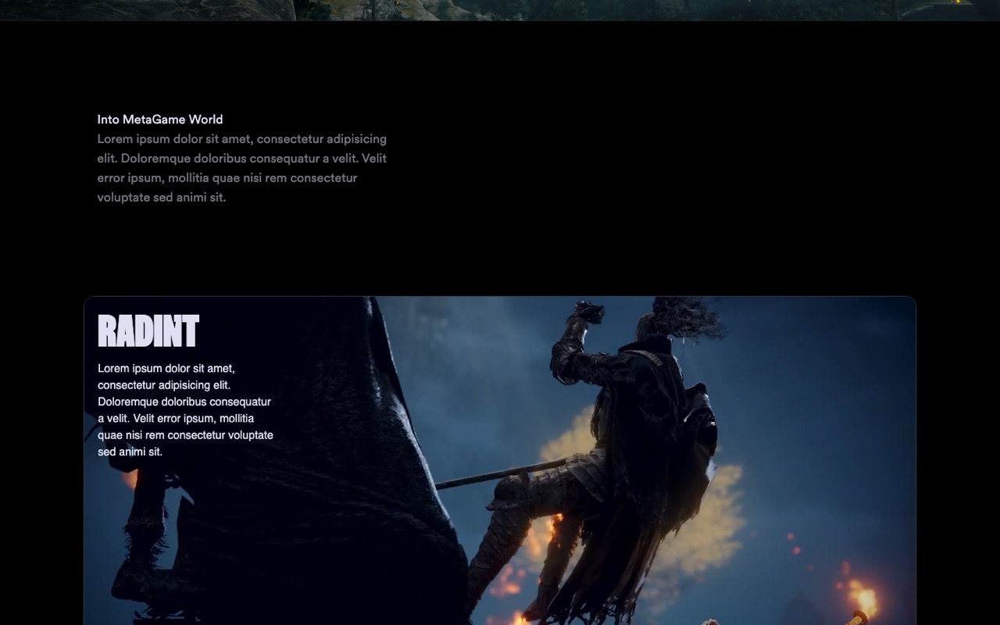
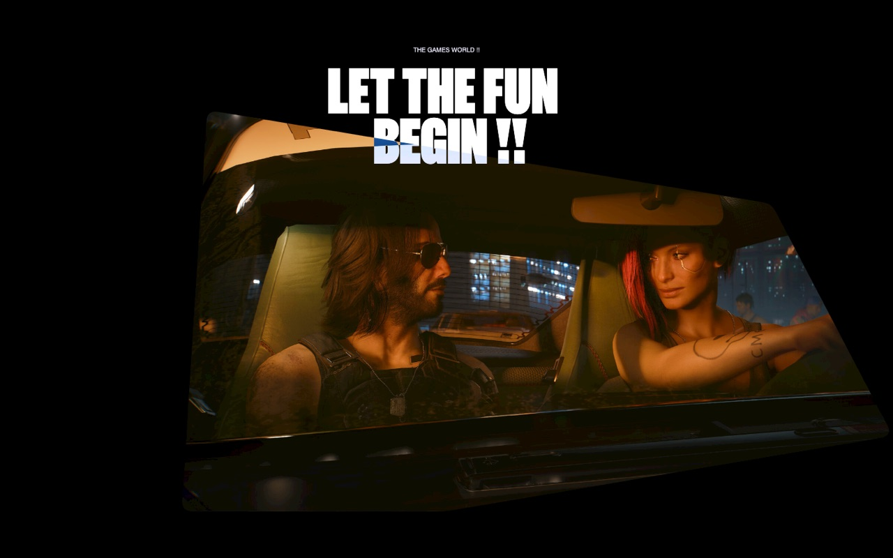
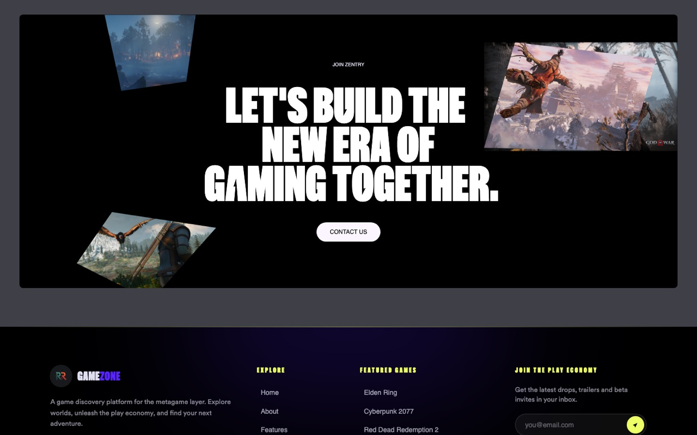
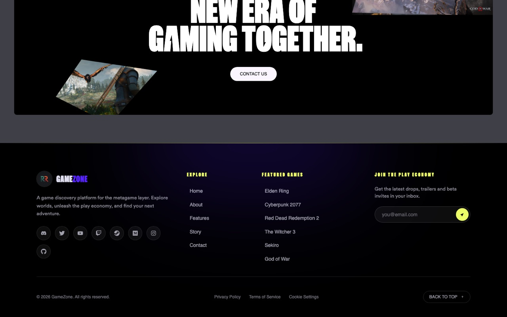

# 🎮 GameZone — Game Discovery Web App

A cinematic, animated game-discovery landing page built with **React**, **Vite**, **Tailwind CSS** and **GSAP**. It showcases featured games with scroll-driven animations, full-screen video hero, a bento-style features grid, and a rich multi-column footer.

> Built as a hands-on project to explore modern front-end animation, layout and design systems.


---

## 📸 Preview

### Hero — full-screen video with animated mini-preview


### About — pinned, scroll-scrubbed image reveal


### Features — tilting bento grid with autoplaying game videos


### Story — 3D tilt image with animated title


### Contact — animated call to action


### Footer — brand, links, newsletter and socials


---

## ✨ Features

- **Full-screen video hero** with a clickable mini-preview that morphs into the next clip.
- **Scroll-driven animations** powered by GSAP `ScrollTrigger` (pinned sections, clip-path reveals, parallax).
- **Bento-style feature grid** whose cards tilt and cast a colored shadow following the cursor.
- **Animated headlines** that assemble word-by-word on scroll.
- **Responsive navigation** with a floating-on-scroll nav bar and an audio indicator toggle.
- **Rich footer** with featured games, explore links, a working newsletter form and a back-to-top button.
- **Real game media** — high-resolution screenshots and official trailers of Elden Ring, Cyberpunk 2077, Red Dead Redemption 2, The Witcher 3, Sekiro and God of War.

---

## 🛠️ Tech Stack

| Layer      | Tech                                            |
| ---------- | ----------------------------------------------- |
| Framework  | React 18                                        |
| Build tool | Vite 6                                          |
| Styling    | Tailwind CSS 3 + custom utility classes         |
| Animation  | GSAP 3 + `@gsap/react` (`useGSAP`, ScrollTrigger) |
| Icons      | `react-icons`                                   |
| Scroll util| `react-use` (`useWindowScroll`)                 |

---

## 📁 Project Structure

```
Game-Web/
├─ public/
│  ├─ audio/          # background loop
│  ├─ fonts/          # zentry, general, robert, circular-web
│  ├─ img/            # game screenshots & logos
│  └─ videos/         # hero + feature videos
├─ docs/
│  └─ screenshots/    # README preview images
├─ src/
│  ├─ components/
│  │  ├─ HeroSection.jsx     # video hero + mini-preview
│  │  ├─ NavBar.jsx          # floating navigation
│  │  ├─ About.jsx           # pinned reveal section
│  │  ├─ Features.jsx        # bento grid (BentoTilt/BentoCard)
│  │  ├─ Story.jsx           # 3D tilt story image
│  │  ├─ Contact.jsx         # CTA section
│  │  ├─ Footer.jsx          # footer
│  │  ├─ AnimatedTitle.jsx   # word-by-word animated heading
│  │  └─ Button.jsx          # reusable button
│  ├─ App.jsx
│  ├─ index.css              # Tailwind + custom utilities/keyframes
│  └─ main.jsx
├─ index.html
├─ tailwind.config.js
└─ vite.config.js
```

---

## 🚀 Getting Started

### Prerequisites

- Node.js 18+
- npm

### Installation

```bash
# clone
git clone https://github.com/RamyRxr/Game-Web.git
cd Game-Web

# install dependencies
npm install

# start dev server
npm run dev
```

Open the printed URL (default: `http://localhost:5173`).

### Available Scripts

| Command           | Description                        |
| ----------------- | --------------------------------- |
| `npm run dev`     | Start the Vite dev server         |
| `npm run build`   | Build for production (`dist/`)    |
| `npm run preview` | Preview the production build      |
| `npm run lint`    | Run ESLint                        |

---

## 🎨 Customization

- **Colors & fonts** — edit `tailwind.config.js` (custom `blue`, `purple`, `yellow` palettes and `zentry`/`general`/`robert` fonts).
- **Animations & utility classes** — see `src/index.css` (`animated-title`, `bento-tilt`, `mask-clip-path`, `story-img-*`, `three-body` loader, etc.).
- **Media** — drop new files into `public/videos` and `public/img`, then update the references in the relevant component.

---

## 🗺️ Roadmap

- [ ] Wire the nav items (`Nexus`, `Vault`, `Prologue`) to real sections
- [ ] Add a games catalog / filtering page
- [x] Compress hero videos for faster first load
- [ ] Deploy to Vercel / Netlify
- [ ] Add page transitions and reduced-motion support

---

## 🙏 Credits

- Design inspired by the **Zentry** JSMastery tutorial.
- Game artwork & trailers © their respective studios, sourced from the **Steam CDN** for demonstration purposes only.
- Fonts and audio assets belong to their original owners.

---

## 📄 License

Released under the **MIT License**. See `LICENSE` for details.

## 👤 Author

**Ramy** — [@RamyRxr](https://github.com/RamyRxr)
